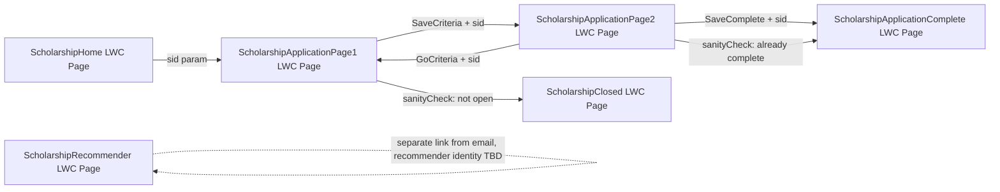

# Implementation Plan — Convert Scholarship Application VF Pages to LWC on Experience Cloud

## Problem Statement

The scholarship application flow currently runs as six classic Visualforce pages
(`ScholarshipHome`, `ScholarshipApplicationPage1`, `ScholarshipApplicationPage2`,
`ScholarshipApplicationComplete`, `ScholarshipClosed`, `ScholarshipRecommender`) composed on a
shared `ScholarshipTemplate2024` VF template, using `ApexPages.currentPage()` cookies/params for
session state, `Attachment` records for essay file uploads, and guest/public-site semantics.
These need to be converted into Lightning Web Components hosted on an already-provisioned
Aura-template Experience Cloud site, for applicants authenticated as Customer Community Login
users tied to Contacts.

## Requirements (gathered)

- Target: Aura Experience Cloud site (already created/configured outside this project — out of
  scope to build).
- Scope: full flow — all 6 pages/controllers.
- Identity: Customer Community Login users, authenticated, mapped to Contact (same identity model
  as today's `UserInfo.getUserId()` → Contact).
- Routing: multi-page — one Experience Builder page per step, LWC per page, using
  `NavigationMixin` for transitions (mirrors current PageReference-redirect structure).
- File upload: switch from `apex:inputFile`/`Attachment` to `lightning-file-upload` with
  `ContentVersion`/`ContentDocumentLink`.
- Data access: imperative calls to custom `@AuraEnabled` Apex methods (mirrors current controller
  methods and the existing `scholarshipEligibleListView`/`scholarshipRecommenderResendLwc` pattern
  already in the codebase), not generic UI API record wires.

## Background / Research Findings

- The org already has a working VF→Aura→LWC bridging pattern: `ScholarshipHome.page` loads
  `c:easyAuraApp` (Aura app) via `$Lightning.use`, which hosts `scholarshipEligibleListView` LWC.
  On the Experience site, this indirection is unnecessary — LWCs can be dropped directly onto
  Experience Builder pages (Aura template sites support LWC natively since LWCs are automatically
  wrapped for Aura compatibility by the platform).
- Existing LWCs (`scholarshipEligibleListView`, `scholarshipRecommenderResendLwc`,
  `scholarshipApplicationControlsLwc`, `selectApplicationControlsLwc`) already establish the
  project's LWC conventions: imperative `@salesforce/apex` calls in `connectedCallback`,
  `ShowToastEvent` for user feedback, `@api` properties for configuration passed from
  parent/page context. New components should follow this same style.
- `ScholarshipSharedUtilities` currently derives scholarship context from an **HTTP cookie**
  (`USTScholarship`) and `sid` URL param, and applicant identity from `UserInfo.getUserId()` →
  `Contact`. On the Experience site:
  - Applicant identity: unchanged — Customer Community Login user → Contact lookup still works
    via `UserInfo.getUserId()`.
  - Scholarship context: cookies don't translate cleanly to LWC/Experience Builder pages. Replace
    with an Experience Builder **page URL parameter** (e.g., `?sid=XXXX`) read via
    `CurrentPageReference`/`lightning/navigation`, eliminating the cookie entirely (cleaner and
    avoids guest-cookie-security concerns that drove the original `Strict` cookie design — not
    needed once truly authenticated).
  - Server-side `ApexPages.currentPage().getParameters()` access must be removed from shared Apex;
    scholarship ID must be passed explicitly as a method argument from each LWC.
- File upload redesign: `lightning-file-upload` produces `ContentVersion` records linked via
  `ContentDocumentLink` to the `Scholarship_Applicant__c` record (as `LinkedEntityId`).
  `Essay_1_Uploaded__c`/`Essay_2_Uploaded__c` checkbox fields and `*_Orig_Filename__c` fields stay
  as-is for backward compatibility with reporting — just populated from
  `ContentVersion.PathOnClient`/title instead of `Attachment.Name` on the server side after
  confirming the upload.
- `ApexPages.Message`/`ApexPages.addMessage` severity-based page messaging has no direct LWC
  analog — replaced by `ShowToastEvent` (transient) plus inline `lightning-messages`/custom banner
  markup for persistent validation errors (e.g., the "Confirm and Continue" checkbox validation,
  essay/recommender validation).
- PageReference-based redirects (`Page.X.setRedirect(...)`, query param propagation like
  `pageMsg`) are replaced by `NavigationMixin.Navigate` to the target Experience Builder page,
  passing `sid` (and optionally a toast-driven message instead of a `pageMsg` query flag).
- `ScholarshipRecommender.page` is a special case: the "recommender" is typically an **external,
  non-applicant person** (a teacher/employer) who likely is **not** a Customer Community Login
  user. This needs explicit handling — confirm whether recommenders will also get community login
  accounts, or whether this page needs to remain a guest-accessible flow (e.g., a separate
  guest-enabled Experience Builder page/profile, or stays as classic VF Sites). This is flagged as
  an open risk to resolve with the Salesforce admin/site owner before building that specific page,
  but does not block the rest of the plan.

## Proposed Solution

Architecture: 6 Experience Builder pages (one per current VF page), each hosting one top-level
LWC. Each top-level LWC:

1. On `connectedCallback`, reads `sid` from the page's URL via `CurrentPageReference`
   (`lightning/navigation`).
2. Calls a new or refactored `@AuraEnabled` Apex method (on a renamed/refactored version of the
   existing controller, or a new `*LwcController` class) to fetch `Scholarship__c` +
   `Scholarship_Applicant__c` data for that `sid` + running user's Contact.
3. Renders the step UI using `lightning-*` base components (replacing SLDS-hand-rolled markup with
   `lightning-input`, `lightning-textarea`, `lightning-input-rich-text`, `lightning-file-upload`,
   `lightning-button`).
4. On save/continue, calls an `@AuraEnabled` Apex method mirroring the current
   `SaveCriteria`/`SaveFinishLater`/`SaveComplete`/etc., then uses `NavigationMixin` to move to the
   next Experience Builder page with `sid` carried in the URL.

Apex layer: introduce one `@AuraEnabled`-bearing Apex class per page (e.g.,
`ScholarshipApplicationPage1LwcController`, `ScholarshipApplicationPage2LwcController`, etc.) that
wraps/reuses logic from `ScholarshipSharedUtilities`, with all cookie/`ApexPages`-current-page
dependencies removed and replaced by explicit parameters. Existing VF controllers remain untouched
(can be deleted in a later cleanup once the VF pages are retired — not part of this plan unless
requested).

## Task Breakdown

### Task 1: Establish shared Apex service layer for LWC consumption (no UI yet)

- Objective: Create `ScholarshipSharedUtilities` additions (or a new `ScholarshipLwcService`
  class) exposing cookie-free, parameter-driven versions of `getScholarshipInfo(String sid)`,
  `getApplicantInfo(Id scholarshipId, Id contactId)`, `isScholarshipOpen`, and
  `checkScholarshipAccess(String sid, Id contactId)` that return simple status rather than
  `PageReference`.
- Guidance: Keep existing VF-facing methods untouched; add new overloads/methods so VF pages keep
  working during transition. Mark new entry points `@AuraEnabled(cacheable=false)` where they
  perform access checks (DML/record-specific), `cacheable=true` for pure reads where applicable.
- Test: Apex unit tests (`@isTest`) covering open/closed/complete scholarship states, missing
  scholarship, and applicant lookup with/without existing record.
- Demo: Run tests in Developer Console/CI showing green Apex test results for the new service
  methods — no UI yet, but the data layer is proven.

### Task 2: Build `ScholarshipHome` LWC (scholarship list) and wire into Experience Builder

- Objective: Create `scholarshipHomeLwc` (or confirm reusing `scholarshipEligibleListView`
  directly on the Experience page) that lists eligible scholarships for the logged-in Contact and
  links to Page 1 with `sid` param.
- Guidance: Since `scholarshipEligibleListView` + `scholarshipEligibleListViewController` already
  do this, this task is mostly about dropping the existing LWC onto the Experience Builder Home
  page directly (bypassing the `easyAuraApp` Aura wrapper) and confirming `contactId`/`currentPage`
  inputs resolve correctly via `@api` properties sourced from page context instead of VF
  `apex:variable`.
- Test: Manual/UI test as a Customer Community Login test user — verify eligible scholarships
  render and links carry correct `sid`.
- Demo: Logging in as a test community user and seeing the scholarship list render on the new
  Experience Builder Home page, with working links.

### Task 3: Build `ScholarshipApplicationPage1` LWC (criteria confirmation)

- Objective: Create `scholarshipCriteriaLwc` + `ScholarshipApplicationPage1LwcController`
  implementing the sanity check (redirect-equivalent), display of scholarship
  name/description/criteria, self-reported GPA/test score inputs (conditionally rendered), and the
  "Confirm and Continue" checkbox + save action using `NavigationMixin` to go to Page 2.
- Guidance: Use `lightning-input` for GPA/test fields, `lightning-input type="checkbox"` for
  criteria confirmation, client-side validation before invoking Apex (mirroring `validateCriteria()`
  JS). Reuse Task 1's service methods.
- Test: Jest unit test for client-side validation logic (checkbox required before enabling
  Continue); Apex test for `SaveCriteria` equivalent (creates/updates `Scholarship_Applicant__c`,
  sets `Scholarship_Date_Started__c`, triggers "started" email only once).
- Demo: A test community user navigates from Home → Page 1, sees scholarship criteria, cannot
  continue without checking the box, and on confirming is navigated to a (stub) Page 2 URL with
  `sid` preserved.

### Task 4: Build `ScholarshipClosed` LWC and wire sanity-check redirects from Page 1

- Objective: Create `scholarshipClosedLwc` + controller showing "not yet open"/"already
  closed"/"currently closed" messaging, and wire Page 1's sanity check to navigate here when
  appropriate.
- Guidance: Port `scholarshipAlreadyClosed`/`scholarshipNotYetOpen` boolean logic from
  `ScholarshipClosedController` into the new service layer; pass `sid` through.
- Test: Apex tests for open/closed/not-yet-open date logic (likely already covered by Task 1
  service tests — extend if needed). Jest test for conditional message rendering.
- Demo: Simulate a closed/not-yet-open scholarship and show the applicant is redirected from Page
  1 to the Closed page with the correct message.

### Task 5: Build `ScholarshipApplicationPage2` LWC — application questions (no essays/recommenders yet)

- Objective: Create `scholarshipApplicationPage2Lwc` + controller rendering the 4 conditional
  question fields (`Question_1..4_Text__c`/`Answer__c`) and the "Save & Finish Later" / "Previous
  Page" actions only (defer essays, recommenders, and final submit to Tasks 6–8).
- Guidance: Use `lightning-textarea`/`lightning-input-rich-text` for answers based on field type;
  reuse `NavigationMixin` to go back to Page 1 (`GoCriteria` equivalent).
- Test: Apex test for `SaveFinishLater` equivalent (upserts applicant, preserves partial data).
  Jest test for conditional question rendering based on scholarship config.
- Demo: Applicant reaches Page 2 from Page 1, fills in visible question fields, clicks "Save &
  Finish Later", and data persists (verified by reloading the page and seeing saved answers).

### Task 6: Add essay handling to Page 2 LWC with `lightning-file-upload`

- Objective: Extend `scholarshipApplicationPage2Lwc` with essay sections — rich text answer input
  and/or `lightning-file-upload` for upload-allowed essays, replacing `Attachment`-based upload
  with `ContentVersion`/`ContentDocumentLink`.
- Guidance: New Apex method `attachEssayFile(Id applicantId, Integer essayNum, Id
  contentDocumentId, String originalFilename)` that creates/validates `ContentDocumentLink`
  (`LinkedEntityId` = applicant record, `ShareType` = 'V'), validates file extension server-side
  (reuse `getFileExtension` logic), sets `Essay_X_Uploaded__c`/`Essay_X_Uploaded_Orig_Filename__c`.
  Add a delete-and-reupload action that removes the `ContentDocumentLink` and resets the flag.
- Test: Apex tests for valid/invalid file extensions, successful link creation, delete/reupload
  flow. Jest test for upload component visibility toggling (upload vs. type-your-answer choice,
  matching current `EssayDelivery` select behavior).
- Demo: Applicant uploads a `.pdf` essay file via the new file upload control, sees confirmation
  text with original filename, and can delete/re-upload; an invalid file type (e.g., `.exe`) is
  rejected with an inline error.

### Task 7: Add recommender request handling to Page 2 LWC

- Objective: Add Recommender 1/2 name/email inputs, "Request Now" actions, and request-sent-date
  display, porting `SendRecommenderEmail` logic into an `@AuraEnabled` method.
- Guidance: Preserve email-template-driven send logic from
  `ScholarshipSharedUtilities.emailUtilities`; reuse directly from Apex (no change needed there —
  just call from the new controller). Disable name/email inputs once a request date exists,
  matching current behavior.
- Test: Apex tests for: recommender saved without send (no "now" flag), recommender saved and
  email sent, exception during email send still saves recommender data. Jest test for
  required-field validation (name + valid email) before enabling "Request Now".
- Demo: Applicant enters a recommender's name/email, clicks "Request Now", and (in a sandbox with
  email deliverability mocked/verified via test email service or debug log) confirms a
  recommendation request record state changes and inputs become disabled.

### Task 8: Wire final Save & Submit flow, completion statement/signature, and navigation to Complete page

- Objective: Add the completion statement + signature/initials input and the "Save & Submit"
  action (`SaveComplete` equivalent) that validates, triggers any pending recommender sends, marks
  the applicant complete, sends the submission confirmation email, and navigates to the Complete
  page.
- Guidance: Port validation logic from `validateApplication()` JS (likely required-field checks
  across questions/essays/signature) into Jest-testable pure functions plus Apex server-side
  validation as the authoritative check.
- Test: Apex test for full submit flow including email-template-missing fallback messaging
  equivalent (toast instead of `pageMsg` query param). Jest test for submit button validation
  gating.
- Demo: A fully filled-out application is submitted end-to-end: applicant clicks "Save & Submit,"
  sees success, and lands on a stub Complete page with `sid` passed through.

### Task 9: Build `ScholarshipApplicationComplete` LWC

- Objective: Create `scholarshipApplicationCompleteLwc` + controller showing confirmation copy,
  recommender request status/dates, and the "what happens next" review/award description.
- Guidance: Port `recommender1EmailStatus`/`recommender2EmailStatus` logic from
  `ScholarshipApplicationCompleteController` (uses `emailUtilities.emailStatus`) unchanged at the
  Apex level — just expose via a new `@AuraEnabled` method.
- Test: Apex test for status display with 0/1/2 recommenders requested. Jest test for conditional
  rendering of recommender blocks.
- Demo: After Task 8's submit, the Complete page now shows real confirmation content, recommender
  send status, and the award-process description — full happy-path flow (Home → Page1 → Page2 →
  Complete) is demoable end-to-end.

### Task 10: Resolve and build `ScholarshipRecommender` LWC (external recommender flow)

- Objective: Once identity model for recommenders is confirmed (see open risk above), build
  `scholarshipRecommenderLwc` + controller allowing the recommender to view the request context
  and submit their recommendation text, then show a "thank you" confirmation state.
- Guidance: If recommenders remain non-authenticated, this page may need to stay on classic VF
  Sites or use a Guest-enabled Experience Builder page with a token-based lookup (e.g., matching on
  a unique link/record Id passed in the email) instead of Contact identity — this diverges from the
  Customer Community Login model used elsewhere, so confirm before building.
- Test: Apex tests for saving `Recommendation__c`/`Recommendation2__c` by recommender number, and
  for the already-submitted ("recComplete") state blocking re-submission.
- Demo: Using a recommendation request link (as sent by Task 7's email), an external recommender
  opens the page, submits their recommendation, and sees the thank-you message; a second visit to
  the same link shows the already-submitted state instead of the form.

### Task 11: End-to-end regression pass and VF decommission readiness

- Objective: Run the full flow end-to-end on the Experience site (Home → Page1 → [Closed, if
  applicable] → Page2 with essays/recommenders → Complete, plus the separate Recommender link
  flow) with real test data, and produce a go/no-go checklist for retiring the original VF
  pages/controllers.
- Guidance: No new code expected here beyond bug fixes found during the pass; this is a
  verification + sign-off task, not a new feature. Confirm `Attachment`-based essays from any
  in-flight applications (started before this migration) are still visible/handled, or plan a
  one-time data migration of existing `Attachment` essay files to `ContentVersion` if needed.
- Test: Full manual regression checklist across all 6 pages/states; confirm existing Apex test
  suite (all tasks' tests) passes together with no regressions to VF-facing methods.
- Demo: Live walkthrough of the entire applicant journey on the Experience Cloud site, end to end,
  with a recorded test scholarship application fully submitted and visible on the
  `Scholarship_Applicant__c` record in Salesforce.

## Open Risks

- **Recommender identity (Task 10)**: recommenders are typically external, non-applicant people
  (teachers/employers) who may not have Customer Community Login accounts. Needs a decision before
  that task starts: give recommenders community accounts, keep `ScholarshipRecommender` on guest
  VF Sites, or use a token-based guest-enabled Experience Builder page.
- **Historical `Attachment` data**: any applications already in progress with essays uploaded as
  `Attachment` records will need either continued support for reading `Attachment`, or a one-time
  migration to `ContentVersion`/`ContentDocumentLink` before cutover.
